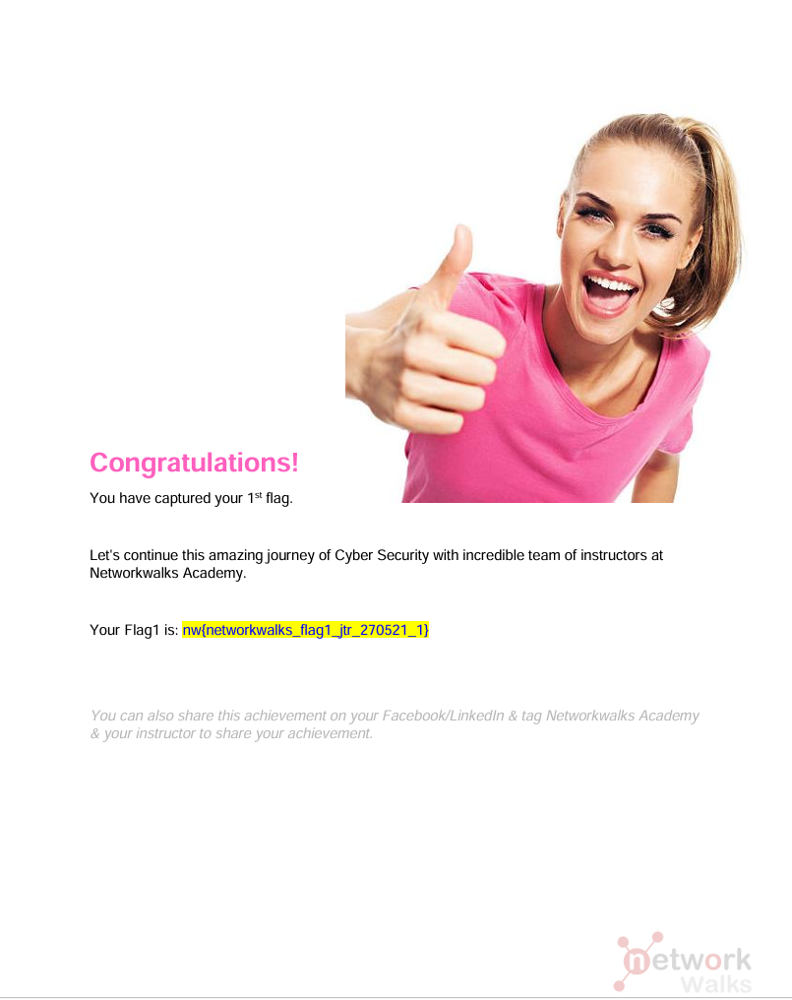
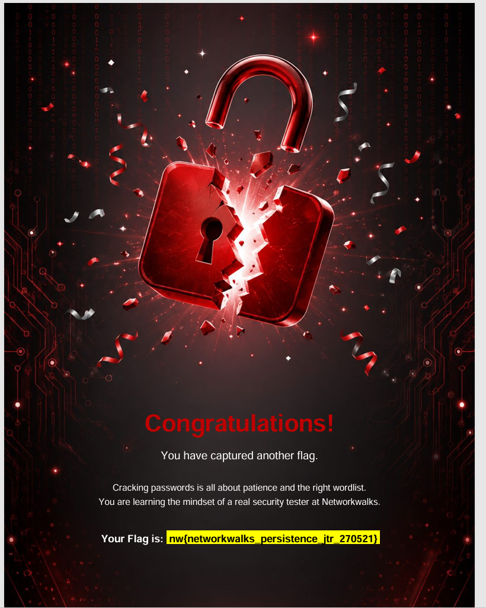
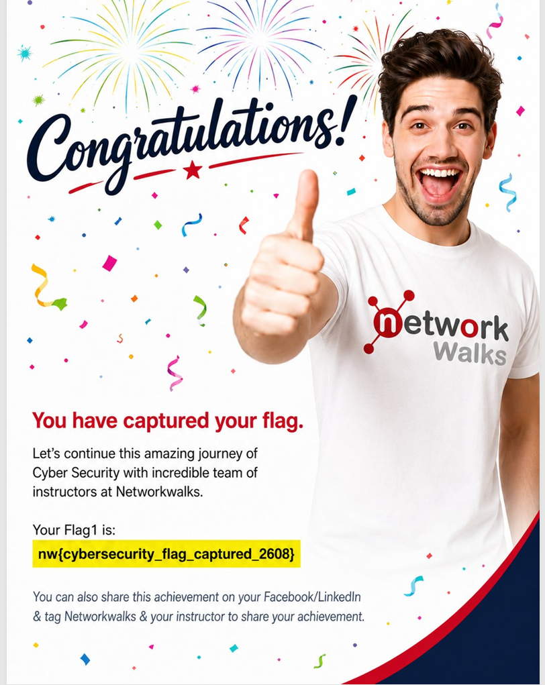
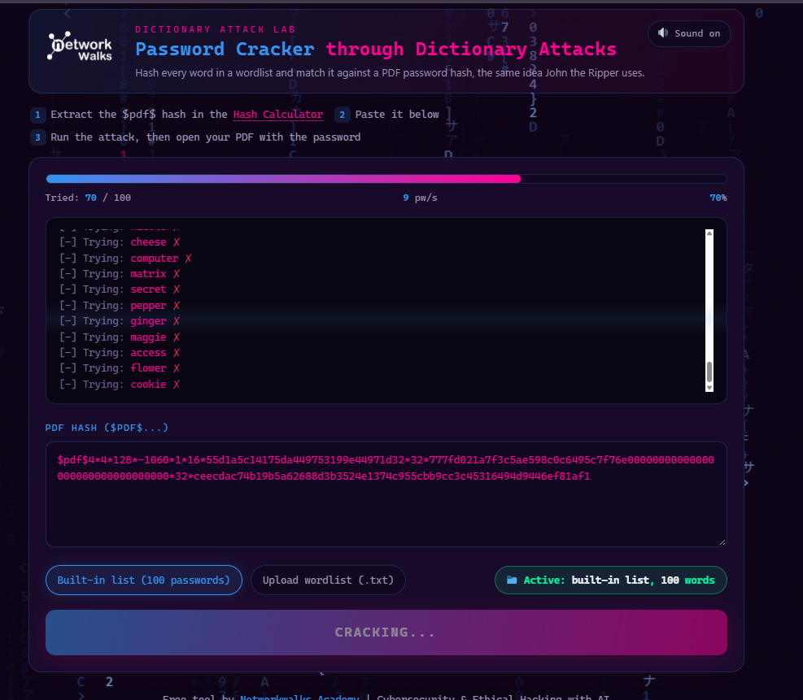
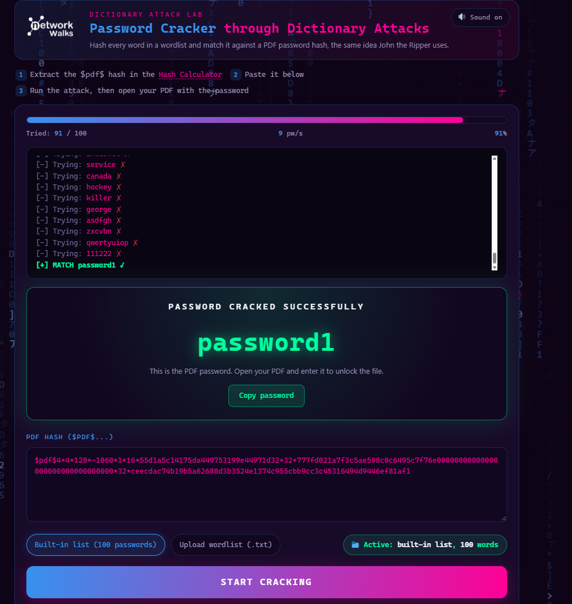

# 🔐 Week 3 Assignment: PDF Password Cracking & Hash Analysis

## 📋 Overview
This repository documents my **Week 3 Cybersecurity & Ethical Hacking** practical assignment completed under **Networkwalks Academy**[cite: 8, 9, 17]. The objective of this lab is to demonstrate how cryptographic password hashes are extracted from encrypted PDF files and audited for strength using dictionary attacks across two different toolsets[cite: 9, 17].

---

## 🎯 Captured Flags

| Module | Tool / Method Used | Cracked Password | Captured Flags |
| :--- | :--- | :--- | :--- |
| **Module 1** | John the Ripper / Johnny (GUI)[cite: 17] | `password1`[cite: 27] | `nw{networkwalks_flag1_jtr_270521_1}`[cite: 1] `nw{networkwalks_persistence_jtr_270521}`[cite: 2] |
| **Module 2** | Networkwalks Hash Calculator & Password Cracker[cite: 9] | `password1`[cite: 5, 13] | `nw{networkwalks_flag_260821_1}`[cite: 3] `nw{cybersecurity_flag_captured_2608}`[cite: 6] |

---

## 🛠️ Lab Walkthrough & Screenshots

### 🔹 Module 1: Password Cracking with John the Ripper (Johnny GUI)
1. **Environment Setup:** Installed **John the Ripper (1.9.0-jumbo-1)** and linked `john.exe` inside the **Johnny GUI** settings[cite: 18, 19, 20].
2. **Hash Extraction:** Extracted the `pdf2john`-compatible hash (`$pdf$4*4*128*...`) from the target encrypted PDF (`My Locked PDF1.pdf`) and saved it as `hash1.txt`[cite: 21, 22, 24].
3. **Dictionary Attack:** Loaded `hash1.txt` into Johnny (`PASSWD format`) and initiated the attack, successfully recovering the password (`password1`)[cite: 25, 26, 27].
4. **Flag Retrieval:** Unlocked the protected PDF using the recovered password to verify and capture the flags[cite: 1, 2, 28, 29].

#### 📸 Module 1 Captured Flags
| Flag 1 (`nw{networkwalks_flag1_jtr_270521_1}`)[cite: 1] | Flag 2 (`nw{networkwalks_persistence_jtr_270521}`)[cite: 2] |
| :---: | :---: |
|  |  |

---

### 🔹 Module 2: Password Cracking with Networkwalks Web Tools
1. **Local Hash Parsing:** Uploaded the encrypted PDF to the **Networkwalks Hash Calculator** to extract the `$pdf$` hash locally in the browser[cite: 10, 11].
2. **Dictionary Attack Execution:** Pasted the extracted hash into the **Networkwalks Password Cracker** and executed a dictionary attack against a wordlist[cite: 4, 12].
3. **Match & Unlock:** Matched the hash against `password1` at 91% wordlist progress and unlocked the target PDFs to capture the remaining flags[cite: 3, 5, 6, 13].

#### 📸 Module 2 Execution & Cracked Password
| Dictionary Attack Running (70%)[cite: 4] | Password Cracked (`password1` at 91%)[cite: 5] |
| :---: | :---: |
|  |  |

#### 📸 Module 2 Captured Flags
| Flag 1 (`nw{networkwalks_flag_260821_1}`)[cite: 3] | Flag 2 (`nw{cybersecurity_flag_captured_2608}`)[cite: 6] |
| :---: | :---: |
|  |  |

---

## 💡 Key Security Takeaways
* **Hashing vs. Encryption:** While the PDF contents are encrypted, the password verification relies on a one-way cryptographic hash that can be extracted and tested offline[cite: 9, 15].
* **Password Entropy Matters:** Simple dictionary words like `password1` are compromised within seconds[cite: 5, 9, 15]. Enforcing strong password length, complexity, and random entropy is critical to resisting offline cracking attacks[cite: 9, 15].

---

## 🙏 Acknowledgments
Special thanks to **Networkwalks Academy** and **Waqas Karim** for designing practical, hands-on cybersecurity labs and providing structured mentorship throughout Week 3[cite: 1, 8, 9, 17].

---
*Disclaimer: All techniques and tools documented in this repository were performed strictly in an authorized educational lab environment for defensive auditing and learning purposes.*
